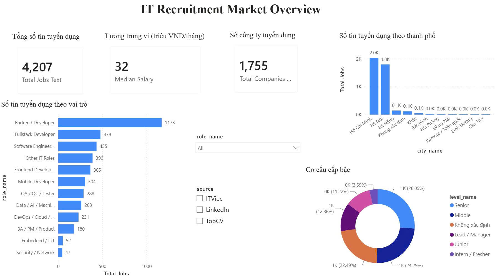
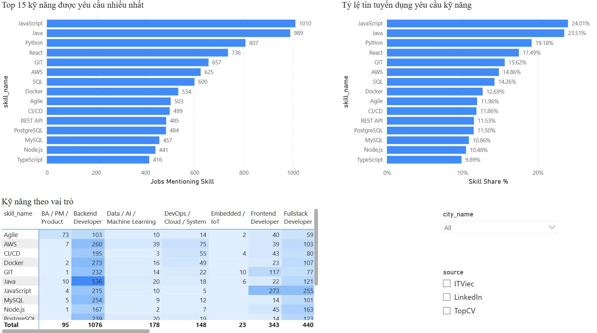
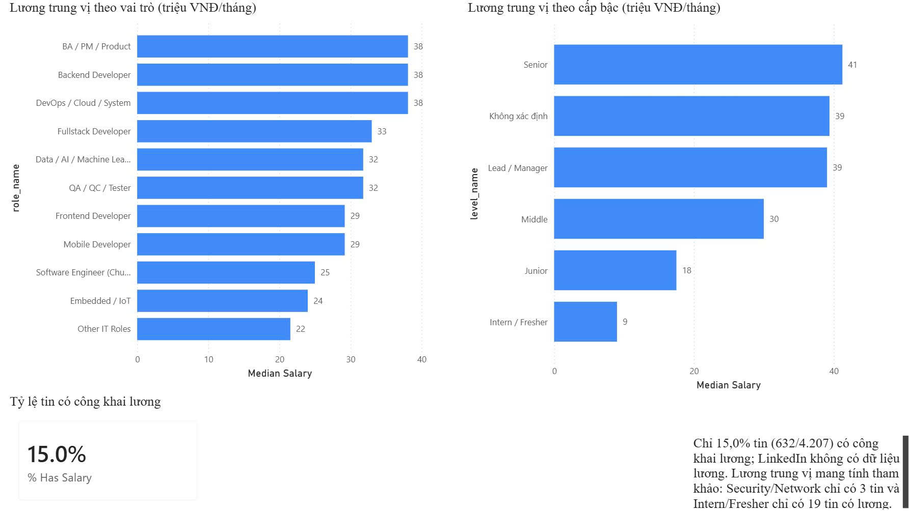
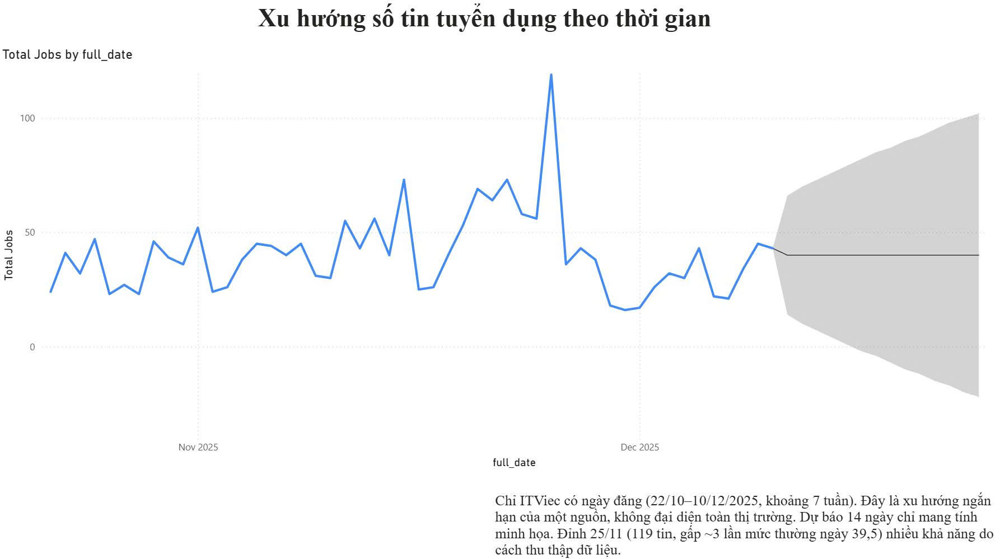

# IT Recruitment Data Analysis in Vietnam
# Phân tích Dữ liệu Tuyển dụng IT Việt Nam

Dự án phân tích dữ liệu tuyển dụng ngành Công nghệ Thông tin tại Việt Nam từ nhiều nền tảng tuyển dụng như ITViec, TopCV và các nguồn dữ liệu liên quan. Dự án tập trung vào việc thu thập, xử lý, tích hợp, xây dựng Data Warehouse và trực quan hóa dữ liệu nhằm khảo sát thị trường lao động IT, nhu cầu kỹ năng công nghệ, phân bố mức lương, cơ cấu cấp bậc và xu hướng tuyển dụng.

---

## 🎯 Mục tiêu Dự án

- Thu thập và tích hợp dữ liệu tuyển dụng IT từ nhiều nguồn.
- Xây dựng quy trình ETL tự động để làm sạch, chuẩn hóa và xử lý dữ liệu.
- Xây dựng Data Warehouse theo mô hình Star Schema phục vụ phân tích.
- Phân tích phân bố tin tuyển dụng theo thành phố, vai trò nghề nghiệp và cấp bậc.
- Khảo sát các kỹ năng công nghệ được yêu cầu nhiều nhất và mức độ yêu cầu kỹ năng theo từng vai trò.
- Phân tích mức lương, tình trạng công khai lương và sự khác biệt giữa các vị trí.
- Khám phá xu hướng tuyển dụng theo thời gian.
- Xây dựng Dashboard Power BI phục vụ trực quan hóa và hỗ trợ khám phá dữ liệu.

---

## 📁 Cấu trúc Thư mục Dự án

```text
IT_Recruitment_Analysis/
├── data/
│   ├── raw/                         # Dữ liệu gốc
│   │   ├── ITViec_data.csv
│   │   ├── TopCV_jobs.csv
│   │   ├── job_descriptions.csv
│   │   └── vietjobs_sample.csv
│   ├── interim/                     # Dữ liệu trung gian
│   ├── processed/                    # Dữ liệu sạch
│   │   └── it_jobs_cleaned.csv
│   └── warehouse/                    # Data Warehouse
│       ├── it_recruitment_dwh.db
│       ├── dim_date.csv
│       ├── dim_city.csv
│       ├── dim_role.csv
│       ├── dim_level.csv
│       ├── dim_company.csv
│       ├── dim_skill.csv
│       ├── fact_job_postings.csv
│       └── fact_job_skills.csv
│
├── src/                               # Mã nguồn ETL
│   ├── extract.py
│   ├── transform.py
│   └── load.py
│
├── notebooks/                          # Jupyter Notebooks
│   ├── 01_data_profiling.ipynb
│   ├── 02_data_cleaning.ipynb
│   ├── 03_data_integration.ipynb
│   └── 04_exploratory_analysis.ipynb
│
├── results/                            # Kết quả phân tích
│   ├── charts/                         # Các biểu đồ phân tích
│   └── tables/                         # Các bảng thống kê
│
├── dashboard/                          # Power BI Dashboard
│   ├── IT_Recruitment_Dashboard.pbix
│   ├── screenshots/                    # Ảnh chụp Dashboard thực tế
│   │   ├── overview.png
│   │   ├── skills_analysis.png
│   │   ├── salary_analysis.png
│   │   └── recruitment_trends.png
│   └── README.md
│
├── reports/                            # Báo cáo và tài liệu dữ liệu
│   ├── data_quality/
│   │   └── cleaning_overview.png
│   ├── cleaning_log.xlsx
│   └── data_dictionary.xlsx
│
├── run_etl_pipeline.py                # Script chạy ETL
├── requirements.txt
└── README.md
```

---

## 🚀 Chạy ETL Pipeline

### Chạy toàn bộ Pipeline

```bash
python run_etl_pipeline.py
```

Pipeline thực hiện 3 giai đoạn:

1. **EXTRACT** – Trích xuất dữ liệu từ các nguồn trong `data/raw/`.
2. **TRANSFORM** – Làm sạch, chuẩn hóa, xử lý dữ liệu trùng lặp và trích xuất đặc trưng.
3. **LOAD** – Nạp dữ liệu vào Data Warehouse theo mô hình Star Schema.

### Chạy từng bước riêng

```bash
python run_etl_pipeline.py --step extract
python run_etl_pipeline.py --step transform
python run_etl_pipeline.py --step load
```

> **Lưu ý:** Các lệnh trên cần được thực thi theo đúng thứ tự và điều kiện đầu vào của từng bước ETL.

---

## 📊 Phân tích Dữ liệu Khám phá (EDA)

Phân tích dữ liệu được thực hiện bằng Python trong Notebook `04_exploratory_analysis.ipynb`. Các biểu đồ và bảng thống kê được xây dựng nhằm khám phá đặc điểm của thị trường tuyển dụng IT.

### 1. Phân bố Tin tuyển dụng

- Số lượng tin tuyển dụng theo thành phố.
- Số lượng tin tuyển dụng theo vai trò nghề nghiệp.

### 2. Phân tích Nhu cầu Kỹ năng

- Top 15 kỹ năng được yêu cầu nhiều nhất.
- Phân bố kỹ năng theo từng vai trò nghề nghiệp.
- Tỷ lệ tin tuyển dụng yêu cầu từng kỹ năng.

### 3. Phân tích Xu hướng Tuyển dụng

- Xu hướng số lượng tin tuyển dụng theo thời gian.
- Tổng số tin tuyển dụng theo từng giai đoạn.
- Quan sát sự thay đổi nhu cầu tuyển dụng trên dữ liệu thu thập được.

### 4. Phân tích Mức lương

- Mức lương theo vai trò nghề nghiệp.
- Mức lương theo cấp bậc.
- Tỷ lệ tin tuyển dụng công khai và không công khai mức lương.

> Các phân tích về mức lương chỉ sử dụng những tin tuyển dụng có thông tin lương hợp lệ. Kết quả mang tính tham khảo trên tập dữ liệu thu thập được, không đại diện tuyệt đối cho toàn bộ thị trường lao động IT Việt Nam.

---

## 📈 Power BI Dashboard

Dashboard được xây dựng bằng Power BI Desktop nhằm trực quan hóa kết quả phân tích và hỗ trợ người xem khám phá dữ liệu tuyển dụng.

### Các trang Dashboard

| Trang Dashboard | Nội dung phân tích |
|---|---|
| Tổng quan | Tổng số tin tuyển dụng, lương trung vị, số công ty tuyển dụng, số tin theo thành phố và vai trò |
| Phân tích kỹ năng | Top 15 kỹ năng, kỹ năng theo vai trò và tỷ lệ tin tuyển dụng yêu cầu kỹ năng |
| Phân tích lương | Mức lương theo vai trò, cấp bậc và tình trạng công khai lương |
| Xu hướng tuyển dụng | Biến động số lượng tin tuyển dụng theo thời gian |

### Giao diện Dashboard thực tế

Các hình ảnh dưới đây là ảnh chụp trực tiếp Dashboard Power BI đã xây dựng trong dự án.

#### Dashboard Tổng quan



#### Dashboard Phân tích kỹ năng



#### Dashboard Phân tích lương



#### Dashboard Xu hướng tuyển dụng



### Mở Dashboard

Mở tệp Power BI tại:

```text
dashboard/IT_Recruitment_Dashboard.pbix
```

---

## 🏗️ Data Warehouse – Star Schema

Data Warehouse được xây dựng trên SQLite và các bảng dữ liệu CSV, phục vụ truy vấn và phân tích dữ liệu tuyển dụng.

### Các bảng Dimension

| Bảng | Nội dung |
|---|---|
| dim_date | Thông tin thời gian |
| dim_city | Thông tin thành phố |
| dim_role | Vai trò nghề nghiệp |
| dim_level | Cấp bậc tuyển dụng |
| dim_company | Thông tin công ty |
| dim_skill | Danh mục kỹ năng |

### Các bảng Fact

| Bảng | Nội dung |
|---|---|
| fact_job_postings | Dữ liệu tin tuyển dụng |
| fact_job_skills | Liên kết giữa tin tuyển dụng và kỹ năng |

### Sơ đồ tổng quan
```
                  ┌──────────────┐
                  │   DIM_DATE   │
                  └──────┬───────┘
                         │
   ┌────────────┐  ┌─────┴──────────┐  ┌──────────────┐
   │  DIM_CITY  ├──┤ FACT_JOB_      ├──┤  DIM_ROLE    │
   └────────────┘  │   POSTINGS     │  └──────────────┘
                   │ (4.207 dòng)   │
   ┌────────────┐  └──┬──────────┬──┘  ┌──────────────┐
   │ DIM_LEVEL  ├─────┘          └─────┤ DIM_COMPANY  │
   └────────────┘                      └──────────────┘

                   ┌─────────────────┐
                   │  FACT_JOB_      │  ┌──────────────┐
                   │    SKILLS       ├──┤  DIM_SKILL   │
                   │ (25.791 dòng)   │  │ (3.104 kn)   │
                   └─────────────────┘  └──────────────┘
```
---

## 📌 Kết quả Hiện tại

### Dữ liệu sau xử lý

| Chỉ tiêu | Kết quả |
|---|---:|
| Dữ liệu thô ban đầu | 4.876 bản ghi |
| Bản ghi trùng lặp được loại bỏ | 585 bản ghi |
| Dữ liệu sạch sau xử lý | 4.207 bản ghi |
| Công ty tuyển dụng | 1.755 |
| Thành phố | 11 |
| Vai trò nghề nghiệp | 12 |
| Kỹ năng riêng biệt | 3.104 |
| Liên kết tin tuyển dụng – kỹ năng | 25.791 |

### Data Warehouse

- 6 bảng Dimension.
- 2 bảng Fact.
- Mô hình Star Schema.
- Dữ liệu được tổ chức phục vụ phân tích và trực quan hóa trên Power BI.

### Kết quả phân tích

- Xác định các thành phố có nhiều tin tuyển dụng IT.
- Khám phá cơ cấu nhu cầu tuyển dụng theo vai trò nghề nghiệp.
- Xác định các kỹ năng công nghệ được yêu cầu phổ biến.
- Phân tích sự khác biệt về kỹ năng giữa các vai trò.
- Khảo sát phân bố mức lương theo vai trò và cấp bậc.
- Đánh giá tình trạng công khai mức lương trong dữ liệu tuyển dụng.
- Quan sát xu hướng tuyển dụng theo thời gian.

---

## ⚠️ Lưu ý

- Dữ liệu được thu thập từ các nền tảng tuyển dụng cụ thể, không bao phủ toàn bộ thị trường IT Việt Nam.
- Các nguồn có thể khác nhau về cấu trúc, cách đặt tên vai trò và cách thể hiện mức lương.
- Số lượng tin tuyển dụng phản ánh dữ liệu thu thập được, không đồng nghĩa hoàn toàn với số lượng vị trí việc làm thực tế.
- Chỉ một phần tin tuyển dụng công khai mức lương; do đó các thống kê lương có thể không đại diện cho toàn bộ thị trường.
- Các kết quả phân tích xu hướng hiện tại mang tính mô tả dữ liệu lịch sử, chưa phải kết quả dự báo.

---

## 🛠️ Cài đặt và Môi trường

### 1. Clone Repository

```bash
git clone https://github.com/HoLeTrungBao/IT_Recruitment_Analysis.git
cd IT_Recruitment_Analysis
```

### 2. Khởi tạo môi trường ảo

```bash
python -m venv .venv
```

### 3. Kích hoạt môi trường ảo

Windows PowerShell:

```powershell
.\.venv\Scripts\Activate.ps1
```

Linux / macOS:

```bash
source .venv/bin/activate
```

### 4. Cài đặt thư viện

```bash
pip install -r requirements.txt
```

### 5. Chạy ETL Pipeline

```bash
python run_etl_pipeline.py
```

### 6. Mở Dashboard

Mở Power BI Desktop và sử dụng tệp:

```text
dashboard/IT_Recruitment_Dashboard.pbix
```
