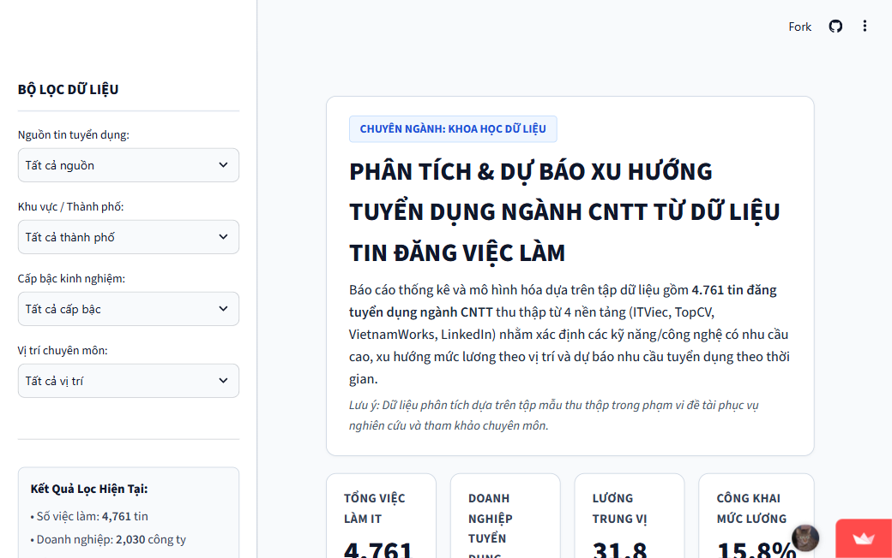
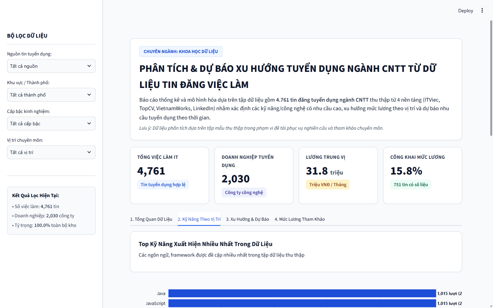
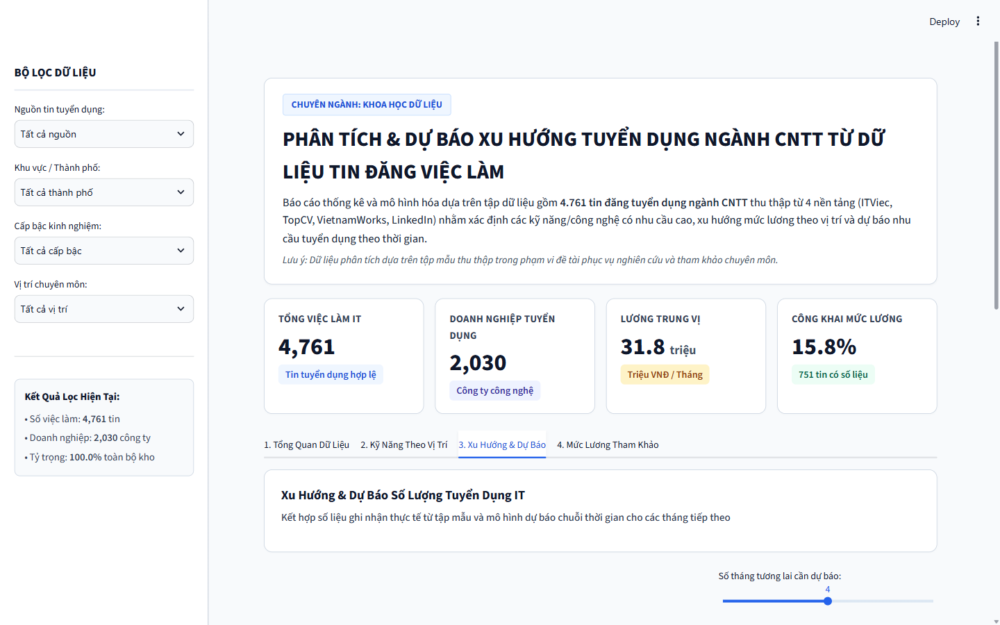
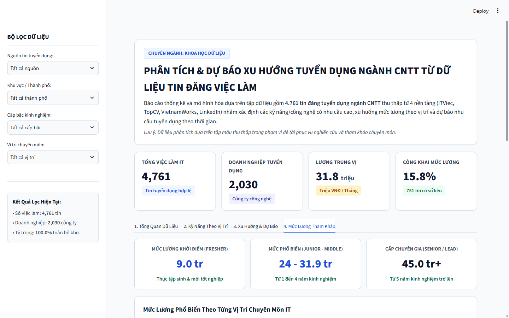

# Phân Tích & Dự Báo Xu Hướng Tuyển Dụng Ngành CNTT Từ Dữ Liệu Tin Đăng Việc Làm

**Chuyên ngành: Khoa học Dữ liệu**  
**Dự án:** Phân tích Dữ liệu & Xây dựng Hệ thống Trực quan hóa, Dự báo Tuyển dụng IT Việt Nam  
**Công nghệ sử dụng:** Python (Pandas, NumPy, Scikit-learn, Statsmodels), SQLite (Data Warehouse / Star Schema), Web Dashboard (Streamlit, Plotly), Power BI Desktop

---

## 📌 Tổng Quan Đề Tài

Dự án tập trung vào việc nghiên cứu, thu thập và xây dựng giải pháp phân tích dữ liệu toàn diện cho thị trường tuyển dụng ngành Công nghệ Thông tin (CNTT) tại Việt Nam từ 4 nền tảng tuyển dụng trực tuyến hàng đầu: **ITViec**, **TopCV**, **VietnamWorks** và **LinkedIn**.

Dự án triển khai một quy trình khép kín từ trích xuất - làm sạch dữ liệu (ETL), lưu trữ mô hình hóa kho dữ liệu (Data Warehouse theo mô hình Star Schema), huấn luyện mô hình dự báo chuỗi thời gian (Time-series Forecasting bằng thuật toán Holt's Linear Trend) đến phát triển ứng dụng Web Dashboard trực quan, tương tác đa chiều phục vụ cho các nhà quản lý, ứng viên và nhà nghiên cứu giáo dục định hướng nghề nghiệp.

---

## 🎯 Mục Tiêu Đề Tài

1. **Thu thập & Tích hợp:** Thu thập và chuẩn hóa dữ liệu tin đăng tuyển dụng ngành CNTT từ nhiều nguồn dữ liệu đa dạng (4 nền tảng trực tuyến).
2. **Quy trình ETL Tự động:** Làm sạch, khử nhiễu, loại bỏ các bản ghi trùng lặp/ngoại lai, trích xuất cấu trúc lương (VND/tháng), địa phương, cấp bậc và từ khóa kỹ năng công nghệ.
3. **Mô hình Kho Dữ liệu (Data Warehouse):** Thiết kế và cài đặt kho dữ liệu quan hệ theo chuẩn mô hình ngôi sao (Star Schema) trên SQLite gồm 6 bảng Dimension và 2 bảng Fact.
4. **Phân tích Nhu cầu Thị trường:** Khảo sát nhu cầu tuyển dụng theo vai trò công việc, địa bàn phân bố và xu hướng kỹ năng/công nghệ được săn đón nhất.
5. **Nghiên cứu Cấu trúc Thu Nhập:** Phân tích phân vị và mức lương trung vị theo cấp bậc kinh nghiệm (Fresher, Junior, Middle, Senior, Lead/Manager) và vị trí chuyên môn.
6. **Mô hình Hóa & Dự Báo Tuyển Dụng:** Ứng dụng mô hình toán học làm mịn hàm mũ tuyến tính Holt (Holt's Linear Exponential Smoothing) từ thư viện `statsmodels` nhằm dự báo biến động nhu cầu nhân lực trong các tháng tiếp theo kèm khoảng dao động tin cậy (Confidence Interval 80%).
7. **Trực quan hóa Đa nền tảng:** Xây dựng Web Dashboard tương tác chuyên nghiệp bằng **Python (Streamlit + Plotly)** và báo cáo chuyên sâu trên **Power BI Desktop**.

---

## 📁 Cấu Trúc Thư Mục Dự Án

```text
IT_Recruitment_Analysis/
├── data/
│   ├── raw/                         # Dữ liệu thu thập gốc từ các nền tảng
│   │   ├── ITViec_data.csv          # Dữ liệu ITViec
│   │   ├── TopCV_jobs.csv           # Dữ liệu TopCV
│   │   ├── job_descriptions.csv     # Dữ liệu VietnamWorks
│   │   └── vietjobs_sample.csv      # Dữ liệu LinkedIn
│   ├── processed/                   # Dữ liệu sạch sau chuẩn hóa
│   │   └── it_jobs_cleaned.csv
│   └── warehouse/                   # Kho dữ liệu SQLite & các file bảng xuất bản
│       ├── it_recruitment_dwh.db     # Cơ sở dữ liệu Data Warehouse (SQLite)
│       ├── dim_date.csv             # Bảng chiều thời gian
│       ├── dim_city.csv             # Bảng chiều tỉnh/thành phố
│       ├── dim_role.csv             # Bảng chiều vị trí/vai trò CNTT
│       ├── dim_level.csv            # Bảng chiều cấp bậc kinh nghiệm
│       ├── dim_company.csv          # Bảng chiều thông tin doanh nghiệp
│       ├── dim_skill.csv            # Bảng chiều từ điển kỹ năng công nghệ
│       ├── fact_job_postings.csv    # Bảng sự kiện tin tuyển dụng
│       └── fact_job_skills.csv      # Bảng sự kiện liên kết việc làm - kỹ năng
│
├── src/                             # Mã nguồn quy trình ETL & Mô hình
│   ├── extract.py                   # Module trích xuất và hợp nhất nguồn dữ liệu
│   ├── transform.py                 # Module làm sạch, regex chuẩn hóa cấp bậc & lương
│   ├── load.py                      # Module nạp dữ liệu vào Star Schema SQLite
│   └── forecast.py                  # Module mô hình dự báo chuỗi thời gian Holt's Trend
│
├── dashboard/                       # Ứng dụng Web Dashboard & Power BI
│   ├── app.py                       # Mã nguồn Web Dashboard trực quan (Streamlit + Plotly)
│   ├── IT_Recruitment_Dashboard.pbix # File Dashboard báo cáo Power BI Desktop
│   └── screenshots/                 # Hình ảnh chụp giao diện báo cáo
│
├── notebooks/                       # Sổ tay phân tích khám phá (Jupyter Notebooks)
│   ├── 01_data_profiling.ipynb      # Khảo sát hiện trạng chất lượng dữ liệu
│   ├── 02_data_cleaning.ipynb       # Thử nghiệm các bước làm sạch & khử trùng
│   ├── 03_data_integration.ipynb    # Thử nghiệm tích hợp nguồn đa cấu trúc
│   └── 04_exploratory_analysis.ipynb # Phân tích thống kê mô tả chuyên sâu (EDA)
│
├── reports/                         # Báo cáo và tài liệu dự án
│   ├── powerbi_dashboard_guide.md   # Hướng dẫn thiết lập dashboard trên Power BI
│   ├── cleaning_log.xlsx            # Nhật ký các quy tắc làm sạch dữ liệu
│   └── data_dictionary.xlsx         # Từ điển dữ liệu chi tiết
│
├── run_etl_pipeline.py              # Script điều phối toàn bộ quy trình ETL tự động
├── requirements.txt                 # Danh sách thư viện Python cần thiết
└── README.md                        # Tài liệu tổng quan dự án
```

---

## ⚙️ Quy Trình ETL & Xử Lý Dữ Liệu (Pipeline)

Quy trình ETL được thiết kế tự động hóa cao, vận hành tuần tự qua 3 giai đoạn:

```
[4 Nguồn Dữ Liệu Thô]
(ITViec, TopCV, VietnamWorks, LinkedIn)
       │
       ▼
 [1. EXTRACT]  --> Đọc, chuyển đổi định dạng, gán nhãn nguồn gốc dữ liệu.
       │
       ▼
[2. TRANSFORM] --> Khử trùng lặp tiêu đề + công ty;
               --> Chuẩn hóa ranh giới từ vựng regex \b(intern|fresher|junior...)\b;
               --> Quy đổi dải lương về đơn vị Triệu VNĐ / Tháng (xử lý ngoại lai);
               --> Chuẩn hóa địa lý (Hà Nội, TP.HCM, Đà Nẵng);
               --> Bóc tách kỹ năng công nghệ đối chiếu từ điển chuẩn.
       │
       ▼
  [3. LOAD]    --> Tạo lập cấu trúc Star Schema, phân bổ khóa Surrogate Key;
               --> Nạp vào kho SQLite (it_recruitment_dwh.db) và xuất CSV phục vụ BI.
```

### Chạy toàn bộ Pipeline ETL:

```bash
python run_etl_pipeline.py
```

*Lệnh trên sẽ tự động đọc dữ liệu thô, thực hiện xử lý chuẩn hóa, cập nhật cơ sở dữ liệu kho và xuất ra toàn bộ bảng dữ liệu phục vụ Dashboard.*

---

## 🏗️ Kiến Trúc Kho Dữ Liệu (Data Warehouse - Star Schema)

Kho dữ liệu được tổ chức theo mô hình ngôi sao (Star Schema), tối ưu cho các truy vấn phân tích tổng hợp (OLAP):

```
                  ┌──────────────┐
                  │   DIM_DATE   │
                  └──────┬───────┘
                         │
    ┌────────────┐ ┌─────┴──────────┐ ┌──────────────┐
    │  DIM_CITY  ├─┤ FACT_JOB_      ├─┤   DIM_ROLE   │
    └────────────┘ │   POSTINGS     │ └──────────────┘
                   │ (4.761 dòng)   │
    ┌────────────┐ └─────┬────────┬─┘ ┌──────────────┐
    │ DIM_LEVEL  ├───────┘        └───┤ DIM_COMPANY  │
    └────────────┘                    └──────────────┘

                   ┌─────────────────┐
                   │  FACT_JOB_      │ ┌──────────────┐
                   │    SKILLS       ├─┤  DIM_SKILL   │
                   │ (26.835 dòng)   │ └──────────────┘
                   └─────────────────┘
```

### Thống Kê Quy Mô Kho Dữ Liệu:

| Thành Phần Bảng | Loại Bảng | Số Bản Ghi | Mô Tả Ý Nghĩa Phân Tích |
|---|:---:|---:|---|
| **fact_job_postings** | Fact | **4.761** | Bản ghi việc làm hợp lệ sau khi làm sạch và loại bỏ trùng lặp |
| **fact_job_skills** | Fact | **26.835** | Các cặp liên kết giữa tin tuyển dụng và kỹ năng yêu cầu |
| **dim_company** | Dimension | **2.030** | Danh mục các doanh nghiệp công nghệ tuyển dụng |
| **dim_skill** | Dimension | **3.078** | Danh mục từ điển kỹ năng/công nghệ chuẩn hóa |
| **dim_role** | Dimension | **11** | Vai trò công việc chuyên môn chuẩn hóa (Backend, Software Engineer, Fullstack, AI/Data, DevOps, Frontend, QA/QC, Mobile, PM/BA, IoT, Security) |
| **dim_level** | Dimension | **5** | Cấp bậc chuẩn hóa: Intern/Fresher, Junior, Middle, Senior, Lead/Manager |
| **dim_city** | Dimension | **4** | Khu vực tuyển dụng chính (TP.HCM, Hà Nội, Đà Nẵng, Khác) |
| **dim_date** | Dimension | **-** | Chiều thời gian (Ngày, Tháng, Năm, Tháng/Năm) |

---

## 🤖 Mô Hình Dự Báo Chuỗi Thời Gian (Forecasting)

* **Thuật toán cốt lõi:** Mô hình san bằng hàm mũ tuyến tính Holt (**Holt's Linear Exponential Smoothing**) thuộc phân nhánh chuỗi thời gian của thư viện `statsmodels.tsa.api`.
* **Đặc tính kỹ thuật:** Mô hình tự động học mức cơ sở (Level - hệ số $\alpha = 0.5$) và xu thế tăng trưởng (Trend - hệ số $\beta = 0.3$), ưu tiên thích ứng theo dữ liệu các tháng gần nhất.
* **Khoảng tin cậy dự báo (Prediction Interval):** Xây dựng dải dao động an toàn $80\%$ ($\pm 1.28 \times \text{RMSE}$) thể hiện khoảng trần và sàn dự kiến cho nhu cầu tuyển dụng IT.
* **Tương tác linh hoạt:** Người dùng trên Dashboard có thể tùy chỉnh thanh trượt dự báo từ **2 đến 6 tháng tiếp theo** để cập nhật kịch bản thị trường thời gian thực.

---

## 🖥️ Ứng Dụng Web Dashboard Trực Quan (Streamlit + Plotly)

Giao diện Web Dashboard được xây dựng hiện đại, thiết kế font chữ sắc nét, độ tương phản cao, 100% tiếng Việt chuẩn mực:

```bash
# Lệnh khởi chạy Web Dashboard
streamlit run dashboard/app.py
```

### Các Phân Hệ Chức Năng & Hình Ảnh Trực Quan Thực Tế:

#### 1. Tab 1: Tổng Quan Dữ Liệu Thị Trường
* **Chỉ số KPI chính:** 4.761 tin tuyển dụng hợp lệ, 2.030 doanh nghiệp công nghệ, lương trung vị 31.8 triệu VNĐ/tháng, 15.8% tin có số liệu lương rõ ràng.
* **Cơ cấu nguồn tuyển dụng:** Biểu đồ Donut thể hiện thị phần dữ liệu (ITViec: 42.5%, TopCV: 25.4%, LinkedIn: 20.5%, VietnamWorks: 11.6%).
* **Phân bố địa lý & vai trò IT:** Biểu đồ thanh ngang thể hiện các trung tâm CNTT lớn (TP.HCM, Hà Nội, Đà Nẵng) và các vị trí tuyển dụng nhiều nhất.



---

#### 2. Tab 2: Kỹ Năng Theo Từng Vị Trí Công Việc
* **Top kỹ năng công nghệ:** Xếp hạng các ngôn ngữ, framework được săn đón nhiều nhất (SQL, Java, Python, React, AWS...).
* **Bộ lọc kỹ năng chuyên sâu:** Thống kê chi tiết tỷ lệ % yêu cầu công nghệ cho từng vị trí nghề nghiệp (Backend, Frontend, Fullstack, DevOps, Mobile, QA/QC, Data/AI) kèm thẻ nhận định tự động.



---

#### 3. Tab 3: Xu Hướng Biến Động & Mô Hình Dự Báo
* **Chuỗi thời gian trực quan:** Mốc thời gian tuyến tính rõ nét theo định dạng Tháng/Năm (`10/2025` đến tương lai).
* **Mô hình Holt's Trend:** Nối tiếp dữ liệu thực tế (xanh dương) bằng đường dự báo tương lai (cam nét đứt) kèm dải bóng mờ vùng dao động tin cậy 80%.
* **Bố cục nhãn số liệu khoa học:** Số liệu điểm đầu (`241`) và điểm tụt dốc (`392`) nằm ngang tách biệt, hoàn toàn không bị đường biểu đồ đè qua.



---

#### 4. Tab 4: Thống Kê Mức Lương Tham Khảo
* **3 mốc thu nhập tiêu chuẩn:** Mức khởi điểm (Fresher: ~9.0 tr), Mức phổ biến (Junior - Middle: 24 - 31.9 tr), Cấp chuyên gia (Senior / Lead: 45.0+ tr).
* **So sánh lương theo vị trí:** Biểu đồ so sánh mức lương trung vị giữa các nhánh nghề CNTT.
* **Bảng thống kê theo cấp bậc:** Chi tiết các mốc Thấp nhất (Sàn), Trung vị và Cao nhất (Trần) sắp xếp tuần tự từ thấp đến cao (Intern/Fresher -> Junior -> Middle -> Senior -> Lead/Manager).



---

## 🚀 Hướng Dẫn Cài Đặt & Vận Hành

### 1. Tải Mã Nguồn Về Máy

```bash
git clone https://github.com/HoLeTrungBao/IT_Recruitment_Analysis.git
cd IT_Recruitment_Analysis
```

### 2. Thiết Lập Môi Trường Ảo Python

```bash
# Tạo môi trường ảo
python -m venv .venv

# Kích hoạt môi trường (Windows PowerShell):
.\.venv\Scripts\Activate.ps1

# Kích hoạt môi trường (Linux / macOS):
source .venv/bin/activate
```

### 3. Cài Đặt Gói Thư Viện

```bash
pip install -r requirements.txt
```

### 4. Vận Hành Dự Án

* **Thực thi luồng ETL (Tái tạo kho dữ liệu):**
  ```bash
  python run_etl_pipeline.py
  ```
* **Mở Web Dashboard:**
  ```bash
  streamlit run dashboard/app.py
  ```
  *Hệ thống sẽ mở giao diện tại địa chỉ: `http://localhost:8501`*

---

## ⚖️ Tuyên Bố Về Phạm Vi Dữ Liệu

* Dữ liệu trong dự án được thu thập từ 4 nền tảng tuyển dụng phục vụ mục đích nghiên cứu học thuật của đồ án môn học chuyên ngành **Khoa học Dữ liệu**.
* Các kết quả phân tích và dự báo mang tính tham khảo chuyên môn trong phạm vi tập mẫu khảo sát (4.761 tin tuyển dụng), không đại diện tuyệt đối cho toàn bộ thị trường lao động CNTT Việt Nam.

---
**Khoa Công Nghệ Thông Tin • Chuyên Ngành Khoa Học Dữ Liệu**  
*Dự Án Phân Tích & Dự Báo Xu Hướng Tuyển Dụng Ngành CNTT*
